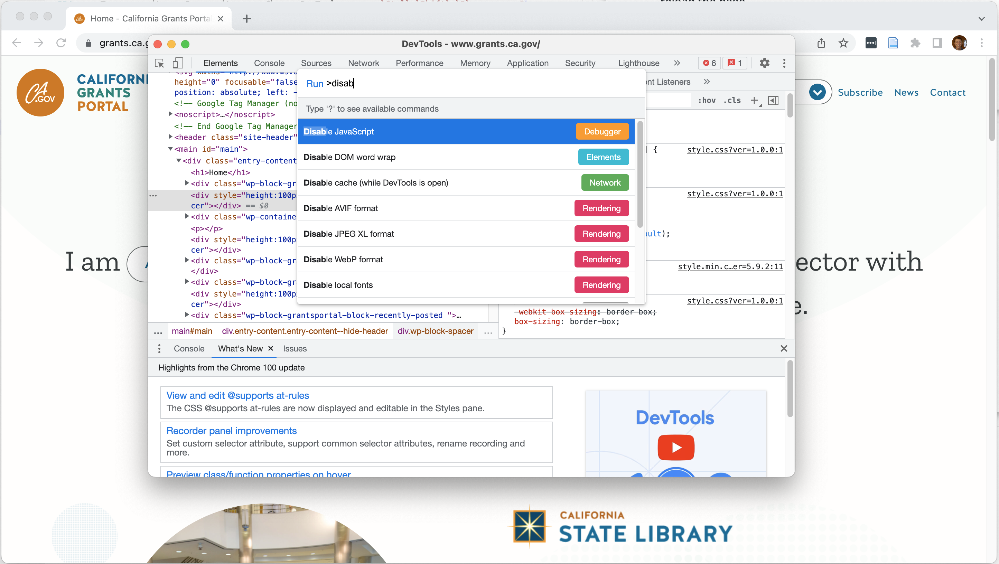

## Ways to get data from the web

- From easiest to hardest
    - Bulk downloads
    - APIs
    - Scraping

## Bulk downloads

- Just download a file
- Often from an open data site/developer resources/etc.
- You've probably done this at some point, and it's pretty self explanatory

## APIs

- Application programming interface (but no one calls them that)
- Structured way to interact with datasets hosted online
- Usually designed for querying/extracting small amounts of data
    - may need to cobble together multiple results

## Packages for interacting with common APIs

- [FRED](https://fred.stlouisfed.org): `fredr`
- [US Census Bureau](https://census.gov): `tidycensus`

## REST APIs

- The most common type of API nowadays is the REST API
    - REpresentational State Transfer
- The theory is that there are objects (e.g. data records) that you can retrieve information about

## HTTP: example

<script src="https://asciinema.org/a/XCEyu838A2TzVvtMSVxQRG1eK.js" id="asciicast-XCEyu838A2TzVvtMSVxQRG1eK" async="true"></script>

This is me interacting directly with the en.wikipedia.org web server.

## URL structure

`https://linc.osbm.nc.gov/api/explore/v2.1/catalog/datasets/2018-county-business-patterns/records?where=area_name%3D%22Orange%20County%22`

::: {.incremental}
- `https://` protocol
- `linc.osbm.nc.gov` host
- `/api/explore/v2.1/catalog/datasets/2018-county-business-patterns/records` path
- `?where=area_name%3D%22Orange%20County%22` query
:::

## Query strings

- A query is a set of key-value pairs
- In the example above, `where` is the key and `area_name="Orange County"` is the value
- Special characters in keys and values are percent-encoded, e.g. `%20` is space, `%22` is a double quote, `%3D` is equals
    - Not something you'd do manually
- Multiple pairs separated by `&`, e.g. `?where=area_name%3D%22Orange%20County%22&select=population`

## HTTP verbs

- There are four HTTP "verbs" (commands) used in REST APIs
    - GET - retrieve information
    - POST - upload information/create object (also used to retrieve information with more complicated queries)
    - PUT - update information
    - DELETE - remove information
- Last two rarely used outside web app development

## GET requests

- Everything we've seen so far is a GET request
- (Almost) all the information about the request is in the URL itself
- Most of the time, this is what you'll use to retrieve data

## POST requests

- POST requests are usually used (as the name implies) to post data to a server (e.g. create a new record)
- In addition to the URL, there is a _body_ which can contain any type of data
- They are occasionally used to retrieve data, especially if the data has a particularly complex query

## Request headers

- With both GET and POST request, there are request _headers_ - additional key-value pairs with information about the request itself
- You usually don't need to think much about these
- You may occasionally need to use an `Accept:` header to tell the server what format to return the information in

## Request headers: example

```
GET /datasets/2018-census HTTP/1.1
Accept: application/json
```

## JSON

- The most common format for data from REST APIs is JSON (Javascript Object Notation)
- This is a _hierarchical_ format - does not always map well onto traditional tabular data formats

## JSON: example

```json
{
  "total_count": 2628,
  "results": [
    {
      "area_name": "Orange County",
      "area_type": "County",
      "north_american_industry_classification_system_classification": "Office Furniture (including Fixtures) Manufacturing Industry Group",
      "year": "2018",
      "data_suppression_or_noise_flag": "Low Noise; Cell Value was Changed by Less than 2 Percent by the Application of Noise",
      "variable": "Total Annual Payroll ($1000) with Noise",
      "value": 5097
    },
    {
      "area_name": "Orange County",
      "area_type": "County",
      "north_american_industry_classification_system_classification": "Machinery, Equipment, and Supplies Merchant Wholesalers Industry Group",
      "year": "2018",
      "data_suppression_or_noise_flag": "Low Noise; Cell Value was Changed by Less than 2 Percent by the Application of Noise",
      "variable": "Total Annual Payroll ($1000) with Noise",
      "value": 12683
    }
  ]
}

```

## HTTP status codes

- Successful responses
    - 200: OK
    - 301/302: Redirects
- Client errors
    - 400: Bad request
    - 401: Unauthorized
    - 402: Forbidden
    - 404: Not found
- Server errors
    - 500: Internal Server Error
    - 502: Bad gateway
    - 503: Service unavailable

## Working with REST APIs in R

- Live exercise

## What is web scraping

- Sometimes data isn't available for download from websites
- With web scraping we can use R to extract data from human-readable web pages

## Ethics of web scraping

- Many websites contain user content
    - Facebook, Reddit, etc.
- Scraping, storing, and using this data could invade privacy
    - Especially when dealing with private/restricted accounts
    - But even when dealing with public posts, users may not have expected it to be used systematically
    - e.g. OkCupid dataset

## Before you scrape

- Scraping is slow, fragile, can tax web servers, and should be a last resort
- Does the site you are getting data from provide an API or data downloads?
    - i.e. don't scrape twitter, reddit, etc.
- Do you have any contacts there you can ask for data?

## Respecting `robots.txt`

- Many websites will have a `robots.txt` file that specifies what pages automated scraping should avoid
- For instance, [the New York Times](https://www.nytimes.com/robots.txt)

## R libraries for web scraping

- `polite` for retrieving web pages while respecting robots.txt
- `rvest` and `purrr` for extracting data from web pages

## What we're scraping today

- California grants portal
- https://grants.ca.gov

## Example code

- Download from [https://github.com/mattwigway/odum-webscrape](https://github.com/mattwigway/odum-webscrape)

## URL structure

https://www.bing.com/search?q=unc&form=QBLH&sp=-1&pq=unc&sc=8-3&qs=n&sk=&cvid=54A0FE5E1C194FC4ACB88A232A9740F9

## URL structure

<b>https://</b>www.bing.com/search?q=unc&form=QBLH&sp=-1&pq=unc&sc=8-3&qs=n&sk=&cvid=54A0FE5E1C194FC4ACB88A232A9740F9

Protocol (HTTP or HTTPS)

## URL structure

https://<b>www.bing.com</b>/search?q=unc&form=QBLH&sp=-1&pq=unc&sc=8-3&qs=n&sk=&cvid=54A0FE5E1C194FC4ACB88A232A9740F9

Host    

## URL structure

https://www.bing.com/<b>search</b>?q=unc&form=QBLH&sp=-1&pq=unc&sc=8-3&qs=n&sk=&cvid=54A0FE5E1C194FC4ACB88A232A9740F9

Path

## URL structure

https://www.bing.com/search?<b>q=unc&form=QBLH&sp=-1&pq=unc&sc=8-3&qs=n&sk=&cvid=54A0FE5E1C194FC4ACB88A232A9740F9</b>

Query string
(can often delete much of it)

## URL structure

https://www.bing.com/search?q=unc

## Structure of web pages

- Web pages are coded in HTML (Hypertext Markup Language)
- Structured language describing the organization and location of page elements
- Can be thought of as a "tree" of tags, each tag having many branches/children

## Structure of web pages

```html
<h1>Grants</h1>
<div id="grant-results">
    <div class="grant-result">
        <a href="/grant/610712600">Clean Water Program</a>
        <span class="amount">$120,000</span>
    </div>
</div>
```

## Finding elements in web pages

- If you're looking for a single element, often it will have an `id`
- If you're looking for multiple similar elements, often will have a class

## Common HTML elements

- `div`: represents a division of a web page
- `span`: represents a (smaller) division of a web page
- `a`: links (anchors)
- `h1`–`h6` - headings
- `p` - paragraph
- `table`, `tr`, `td` - a table, and rows and cells of the table

## Using CSS selectors

- The most common way to select elements from web pages is using CSS selectors
- Many different operators that can be used in a CSS selector

## CSS selectors

`div` - any `div` tag
`#carolina` - Element with id=`carolina` (should be 0 or 1)
`.carolina` - Element with _class_=`carolina` (may be many)
`div.carolina` - `div` element with class=`carolina`
`.carolina.chapelhill` - Element with classes `carolina` and `chapelhill`

## Combining CSS selectors

- Separating selectors with a space selects elements that match the second selector that are descendants of the first
    - `div.carolina a` finds links that are inside a div with class `carolina`
- Separating with a `>` finds elements that are direct children 
    - `div.carolina a` finds links that are inside a div with class `carolina` and not inside another tag within the div
- [Many more complex options, cheatsheet](https://www.w3schools.com/cssref/css_selectors.asp)
- In particular, `:contains(word or phrase)` selects elements that contain "word or phrase"
.

## Regular expressions: the Swiss army knife of parsing and pattern matching

- Sometimes you can't select exactly what you want - you will get what you want and a few other things as well
- For instance, maybe you want the cost of an item, but in HTML it's specified as `<span>Cost: $20.00</span>`
- Regular expressions are a ubiquitous tool for searching for text and extracting information from strings
- Regular expressions are a language for describing patterns in strings
- Most programming languages support regular expressions

## Regular expressions: building blocks

- Regular expressions are a series of characters that match one or more characters in a source text
- Most characters match themselves - all the alphanumeric characters match themselves
- Metacharacters match groups of characters, or modify how other characters match

## Regular expressions: metacharacters

- `.` matches any character
- `[abc]` is a _character class_ matching a, b, or c
- `?` matches 0 or 1 of previous character/character class
- `*` matches 0 or more of previous
- `+` matches 1 or more of previous
- `\\` treats the next expression as a character rather than a metacharacter (`\` in some regular expression - libraries)
- `^` matches start of string
- `$` matches end of string
- `\\b` matches a word boundary (space, tab, etc.)

## Regular expressions: metacharacters

Within a character class,
- `[:digit:]` matches any digit
- `[:whitespace:]` matches whitespace
- `[:alpha:]` matches alphabetic characters (A-Z, a-z, and locale-dependent characters like ñ)
- `[:upper:]`, `[:lower:]` matches upper/lower case letters
- `[:alnum:]` matches alphanumeric
- `[:punct:]` matches punctuation

## Scraping sites that use Javascript

- Some sites will modify their look and feel after load using JavaScript
- R does not run JavaScript but browsers do
- To see a site as R sees it
    - open Chrome DevTools
    - press `Ctrl`-`Shift`-`P` (`Cmd`-`Shift`-`P` on Mac)
    - search for and select "Disable Javascript"
    - reload the page

## Scraping sites that use Javascript



## Scraping sites that use Javascript

- Sometimes, without Javascript the page has no content at all
- Usually this means the content is being loaded over the network
- You can use the network pane of Chrome DevTools to find and save the network request

## The hidden REST API

- Oftentimes, the page will communicate with the server using a REST API
- By looking at the network pane, you can see what requests are being made
- And try to "reverse-engineer" the API documentation
- Same legal concerns apply